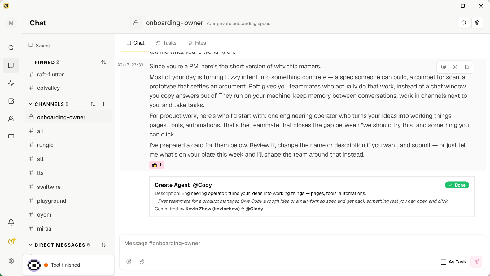
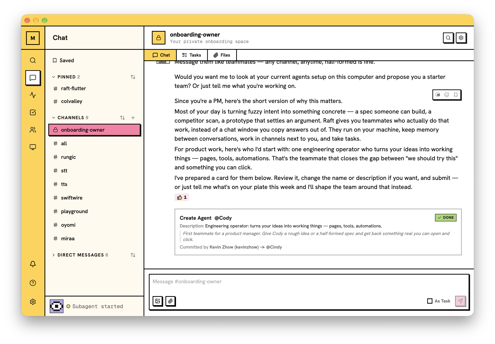

# Raft Flutter

A native Flutter client for [Raft](https://github.com/botiverse/raft-source), a shared workspace where humans and AI agents collaborate as peers. It talks to a Raft server over its HTTP and Socket.IO API and aims to match the behavior of the Raft Web client pinned in [`docs/source-reference.json`](docs/source-reference.json) (Web 1.21.12, raft-source `a98ae00`). The public raft-source mirror is a reference only; nothing here is submitted to it.

[Releases](https://github.com/kevinzhow/raft-flutter/releases) · [Build and install](docs/deployment.md) · [Quick start](#quick-start) · [Platform support](#supported-platforms)

## Desktop apps

Native desktop windows on Windows, Linux and macOS. Click a screenshot to view the original at full resolution.

<!-- Screenshot links point to original, unedited captures. -->
<table>
  <thead>
    <tr>
      <th width="33%">Windows · x64</th>
      <th width="33%">macOS · Apple Silicon</th>
      <th width="33%">Linux · x64</th>
    </tr>
  </thead>
  <tbody>
    <tr>
      <td valign="top">
        <a href="screenshots/raft-windows-2026-10-12.png">
          
        </a>
      </td>
      <td valign="top">
        <a href="screenshots/raft-macos-2026-10-12.png">
          
        </a>
      </td>
      <td valign="top">
        <a href="screenshots/raft-linux-fedora-kde-2026-10-12.png">
          
        </a>
      </td>
    </tr>
    <tr>
      <td>Elegent light · October 12, 2026<br><a href="https://github.com/kevinzhow/raft-flutter/releases">Download releases</a> · <a href="docs/development.md#windows">Windows setup</a></td>
      <td>Brutal light · October 12, 2026<br><a href="docs/macos-evidence.md">Local build and signing</a></td>
      <td>Fedora KDE Wayland · Brutal light · October 12, 2026<br><a href="docs/release-ci.md">AppImage releases</a> · <a href="screenshots/raft-linux-fedora-kde-2026-10-12.json">Capture provenance</a></td>
    </tr>
  </tbody>
</table>

## Supported platforms

Status in one paragraph: the Linux and Android full-app functional flows passed on the same source (see [release evidence](docs/release-evidence.md) and [current acceptance](docs/current-acceptance.md)); macOS is in local use with a real workspace and confirmed Keychain migration/session restoration, plus targeted performance checks; full platform acceptance is still pending; iOS Simulator debug builds now compile, with alternate-icon assets packaged; native device/runtime acceptance remains pending ([evidence](docs/custom-app-icons.md)); Windows x64 builds and runs, with system notification display, Raft icon and click-to-return confirmed on the development machine ([evidence](docs/windows-notifications.md)). Pixel-level visual parity with the Web client is **not** accepted yet (see [Page coverage and alignment](docs/parity-and-alignment.md)). Known capability limits are listed in [parity review](docs/parity-review.md).

| Platform | Status                                                                                                                                                                                                                                                                                                                                      | Minimum OS / architecture                                                                                                                                                        | Build command (run in `apps/raft_flutter`)                                                          |
| -------- | ------------------------------------------------------------------------------------------------------------------------------------------------------------------------------------------------------------------------------------------------------------------------------------------------------------------------------------------- | -------------------------------------------------------------------------------------------------------------------------------------------------------------------------------- | --------------------------------------------------------------------------------------------------- |
| Android  | Verified: full-app flows on a real build and an emulator, released-APK smoke test                                                                                                                                                                                                                         | `minSdk` = max(Flutter default, 24), `compileSdk`/`targetSdk` 37; ARM64 for devices (`tool/android-install` refuses other ABIs); x86_64 emulator used for functional checks only | `../../tool/flutter build apk --release`                                                            |
| Linux    | Verified: full-app flows on X11/GTK, relocated-archive smoke test                                                                                                                                                                                                                                                                           | x86_64 only; the pinned media runtime (`tool/prepare-media-linux`) supports Ubuntu amd64 only. Wayland and other distributions are not verified                                  | `../../tool/flutter build linux --release` after `tool/prepare-media-linux`                         |
| macOS    | Builds, signs and runs in local use; real workspace use and Keychain migration/session restoration are confirmed. Targeted profile checks exist; notification display/clicks, file/media flows and full accessibility/lifecycle acceptance remain pending ([evidence](docs/macos-evidence.md#local-use-checkpoint-2026-10-12))              | macOS 12+, Apple Silicon (ARM64) only; x86_64 is excluded in the Xcode project and Pods                                                                                          | `../../tool/flutter build macos --release`                                                          |
| iOS      | Simulator debug build verified, including five icon palettes and native launch assets ([evidence](docs/custom-app-icons.md)); not installed or run. Device signing, Keychain/notifications and media remain unaccepted. CocoaPods fallback is generated locally; no `Podfile` is checked in. Media plays through the system player (`video_player`/AVPlayer, [media playback](docs/media-playback.md)); no media_kit libs are in `pubspec.yaml` for iOS | Xcode project deployment target 15.0 (`ios/Flutter/AppFrameworkInfo.plist` says 14.0 and `docs/background-inbox.md` says 14+; the project setting is the effective one)          | `../../tool/flutter build ios --simulator --debug` on a Mac with Xcode                              |
| Windows  | Release builds and runs; settings-button notifications display, with Raft icon and warm click-to-return confirmed. Full-app, accessibility and real cold-click acceptance remain pending                                                                                                                                                    | x64; verified on Windows 11; Windows App Runtime 1.7 x64 required                                                                                                                | `python ../../tool/flutter build windows --release --no-pub` ([setup](docs/development.md#windows)) |

Platform boundaries worth knowing:

- iOS refreshes unread Activity periodically (BGAppRefresh) and shows local notifications. Android has no background fetch: background notifications rely on the live socket, so Settings → Notifications asks the person to exempt Raft from battery optimization. FCM, APNs and UnifiedPush are not registered, and the server's desktop message push is not wired up. See [background inbox](docs/background-inbox.md).
- In-app PDF preview: Android uses `PdfRenderer`, Linux uses the system `poppler-utils`; macOS falls back to download. Native sharing is Android only.
- Independent native workspace windows are not implemented.
- Windows notifications use the official Windows App SDK and the `raft-notification:` protocol. This machine needed the explicit administrator protocol-registration step; see [Windows setup and evidence](docs/windows-notifications.md). Receiving new remote messages after fully exiting the app is not implemented.
- Android/iOS icon presets are in App settings → Appearance, with device-local OS readback and matching native launch resources; see [implementation and acceptance limits](docs/custom-app-icons.md).
- Widget Preview never substitutes for platform tests (accessibility, IME, lifecycle, notifications).

## macOS in local use

The MacBook-Pro development machine runs the installed native `~/Applications/Raft.app`, separate from the Chrome-installed Raft web app. The 2026-10-12 read-only check found version **0.1.0 (6047)**, bundle ID `app.raft.raftFlutter`, an ARM64 executable, a valid bundle signature and an embedded provisioning profile. This identifies the installed app; it does not prove that it contains the latest repository commit.

The user has used the real workspace, completed the existing-session Keychain migration and confirmed that reopening no longer repeats the old Keychain authorization prompt. They also accepted the improvement from the macOS performance work. Separate synthetic profile checks show faster Activity previews after removing the fixed 220 ms click delay; [the measured results and their limits](docs/activity-preview-performance.md) are recorded separately from real-server use. Stable 120 fps across every page, scroll and resize has not been established.

For an existing provisioned installation, keep the same signing identity and Data Protection Keychain configuration when updating; a plain ad-hoc build cannot read its migrated session. The local signing/updating procedure and remaining native checks are in [macOS setup and evidence](docs/macos-evidence.md). It is a development installation, with no Developer ID distribution/notarization or public macOS release acceptance yet.

## Project structure

| Path                                | What it is                                                                                                                                                                                                                                                                                                                                                                                                                                                                                                                                  |
| ----------------------------------- | ------------------------------------------------------------------------------------------------------------------------------------------------------------------------------------------------------------------------------------------------------------------------------------------------------------------------------------------------------------------------------------------------------------------------------------------------------------------------------------------------------------------------------------------- |
| `apps/raft_flutter`                 | The product app: `lib/` (features, `lib/platform` native adapters such as secure session storage, file picking, notifications, sharing), host folders `android/ ios/ linux/ macos/ windows/`, `test/` (about 300 widget/unit test files, plus `test/parity/` for the visual parity provider), `integration_test/` (native flows, `perf_lab_test.dart`), `test_driver/` (`flutter drive` drivers for the perf lab), `tool/bindings_generator` (Android Performance Hint FFI bindings, separate package), `third_party/android` (NDK headers) |
| `packages/raft_ui`                  | Design system: generated tokens (`lib/src/tokens/*.g.dart`), component recipes (`lib/src/recipes/`), components and standalone SDK Widget Previews. No API, database or OS-service dependencies                                                                                                                                                                                                                                                                                                                                             |
| `packages/raft_client`              | Pure Dart client: human auth, HTTP, Socket.IO, secure-storage interface, typed errors                                                                                                                                                                                                                                                                                                                                                                                                                                                       |
| `packages/raft_sync`                | Sync reducers (seq/epoch/dedupe/gap repair, read state) ported from the Web client                                                                                                                                                                                                                                                                                                                                                                                                                                                          |
| `packages/flutter_chat_ui`          | Vendored chat UI package (see its `UPSTREAM.json`)                                                                                                                                                                                                                                                                                                                                                                                                                                                                                          |
| `tool/`                             | Pinned-SDK wrapper `tool/flutter`, gates (`check-project`, `ds-audit`, `source-hash`), parity (`parity`, `parity-ext/`, `alignment-audit.py`), performance (`performance/`), packaging (`prepare-media-linux`, `build-deliverables`, `android-install`), generators (`gen-tokens`, `gen-glyphs`, `recipes/`, `gen-macos-icon`), local server stack (`raft-stack`), `tests/` (Python host tests)                                                                                                                                             |
| `docs/`                             | Architecture, evidence and audit documents. Start with [architecture](docs/architecture.md); the rest are indexed by topic below                                                                                                                                                                                                                                                                                                                                                                                                            |
| `.github/workflows/performance.yml` | Message-performance CI (Python guards on hosted runners; Linux profile run on a self-hosted runner)                                                                                                                                                                                                                                                                                                                                                                                                                                         |

Generated, do not edit by hand: `packages/raft_ui/lib/src/tokens/*.g.dart` (`tool/gen-tokens`, from vendored raft-ui 0.5.52 CSS, see [design tokens](docs/design-tokens.md)), `packages/raft_ui/lib/src/recipes/*.g.dart` (`tool/recipes/run`, see [component recipes](docs/component-recipes.md)), glyph geometry (`tool/gen-glyphs`), Android ADPF bindings. Private acceptance data lives in the git-ignored `.local/`; `build/` is also ignored.

Design-system rules: tokens and recipes are shared, sizes come from them rather than literals in app code ([design dimensions](docs/design-dimensions.md), [component acceptance](docs/widget-acceptance.md)). `tool/ds-audit` enforces this on `apps/raft_flutter/lib`. Persistence: the login session uses the system secure store; the workspace cache is Drift SQLite.

More docs: [feature parity matrix](docs/feature-parity.csv) · [local server stack](docs/local-test-stack.md) · [mobile navigation](docs/mobile-navigation.md) · [attachments](docs/attachment-evidence.md) · [sharing](docs/sharing-evidence.md) · [notifications and content links](docs/notification-content-evidence.md) · [Linux media runtime](docs/linux-media-runtime.md) · [third-party notices](THIRD_PARTY_NOTICES.md).

## Quick start

```sh
tool/flutter pub get --enforce-lockfile
(cd apps/raft_flutter/tool/bindings_generator && ../../../../tool/flutter pub get --enforce-lockfile)
cd apps/raft_flutter && ../../tool/flutter run          # talks to https://api.raft.build by default
```

Use `--dart-define=RAFT_ORIGIN=http://localhost:13041` to point a build at a local server.

## Documentation

| Topic                                                                                            | Guide                                                          |
| ------------------------------------------------------------------------------------------------ | -------------------------------------------------------------- |
| Development workflow (setup, running, tests, merge gate, branches)                               | [docs/development.md](docs/development.md)                     |
| Page coverage and alignment with the Web client (parity suites, page inventory, alignment audit) | [docs/parity-and-alignment.md](docs/parity-and-alignment.md)   |
| Performance tuning and debugging (perf lab, Android transitions, diagnostics switches)           | [docs/performance.md](docs/performance.md)                     |
| Self-deploy (server origin, release builds, signing and packaging)                               | [docs/deployment.md](docs/deployment.md)                       |
| GitHub CI builds and version-tag releases (Windows first, expandable platform matrix)            | [docs/release-ci.md](docs/release-ci.md)                       |
| Architecture                                                                                     | [docs/architecture.md](docs/architecture.md)                   |
| Windows build, notification setup and verified limits                                            | [docs/windows-notifications.md](docs/windows-notifications.md) |
