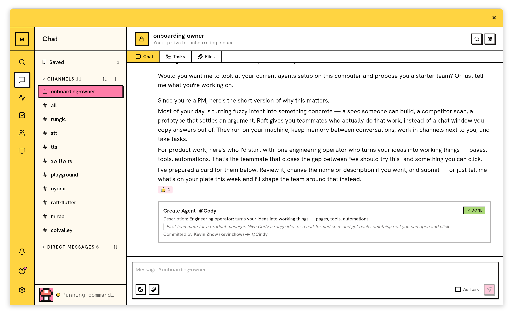
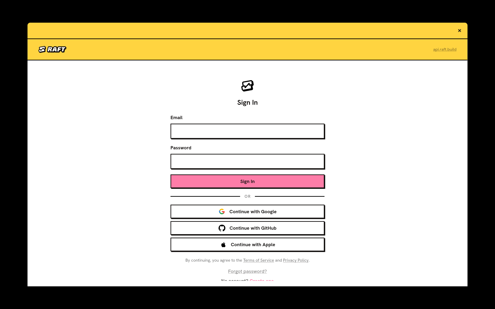
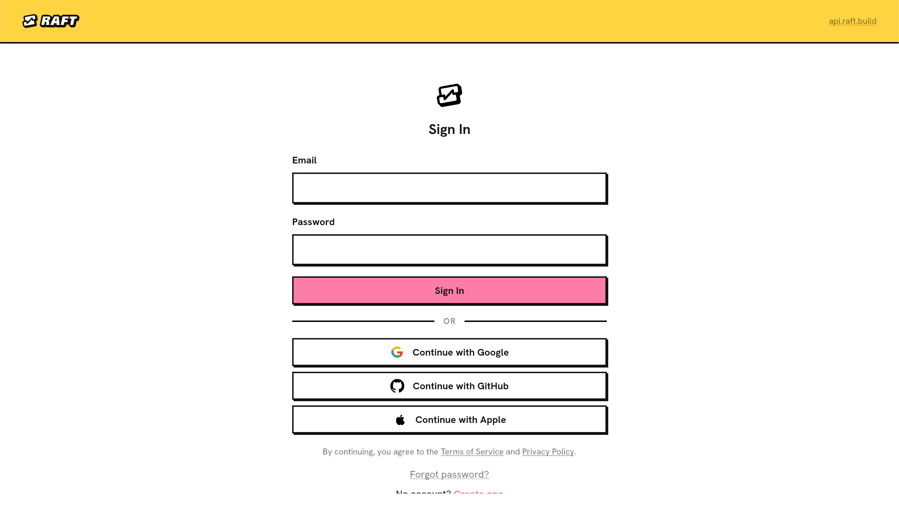

# Linux desktop screenshot

Kevin provided this original screenshot from his Fedora KDE Wayland desktop on
October 12, 2026 and requested its use in the main README. It shows an authenticated
workspace in the Brutal light theme. The image is unchanged; its capture scale was
not supplied. This screenshot does not establish full feature or pixel-parity acceptance.

[Capture provenance and digest](raft-linux-fedora-kde-2026-10-12.json).

# Fedora KDE Wayland AppImage screenshot

This original 2880 × 1800 PNG captures a disposable Fedora 44 KWin output with
2× monitor scaling. Raft connects with `GDK_BACKEND=wayland`; its own Wayland
surface received scale 2 and submitted buffers. The container has no `/dev/fuse`.
KWin is nested on Xvfb and uses software rendering; the capture reads its actual
composited output. This proves native Wayland startup and painting, not the user's
physical GPU, login or full feature acceptance.

[Source, capture method and digests](raft-linux-appimage-fedora-wayland-hidpi-2026-10-12.json).

# Linux AppImage screenshot

The 2560 × 1440 PNG is an original production AppImage window capture on Ubuntu
24.04 at actual `GDK_SCALE=2`, not an enlarged image. The direct launch,
extract-and-run launch and bundled PDF conversion passed. No account or workspace
was imported. This proves native startup, not login or full feature acceptance.

[Source build and startup checks](https://github.com/kevinzhow/raft-flutter/actions/runs/38247319392).
That run's Fedora setup failed before executing the AppImage; later compatibility
results are recorded separately. [Source, scaling and digests](raft-linux-appimage-hidpi-2026-10-12.json).

The older Flatpak screenshot below is retained as historical evidence. Releases
now use AppImage; Flatpak is no longer a release target.

# Historical Flatpak screenshot

The 2560 × 1440 PNG is an original window capture at actual `GDK_SCALE=2`,
not an enlarged image. It shows the production app in a fresh Flatpak desktop
with a working Secret Service keyring. No account or workspace was imported.

[Build and native startup check](https://github.com/kevinzhow/raft-flutter/actions/runs/38237992017).
Source commit, scale and image SHA-256 are recorded in
[the screenshot metadata](raft-linux-flatpak-hidpi-2026-10-12.json).
This screenshot does not establish login, messaging or full platform acceptance.
